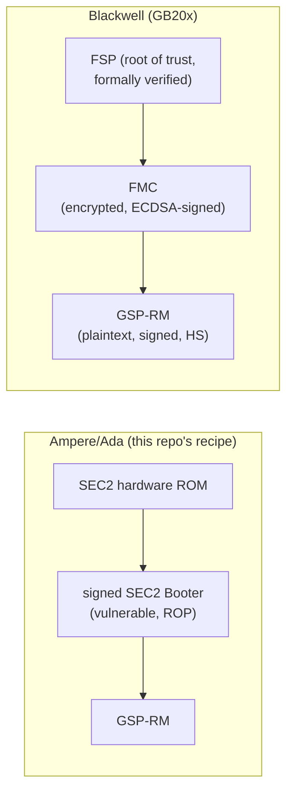

# Blackwell GB20x unlock — research notes

Working notes for a possible Blackwell (GB20x) path. These are findings, not
support: the Ampere recipe in this tree does not carry over to Blackwell, and
nothing here has written to a Blackwell GPU.

## TL;DR

- The consumer Blackwell cap (RTX 5090: `fmla32` and `imla1/2/4` at 1/8 rate)
  comes from **fuses and is enforced in hardware**; the FEAT_OVR/SS register
  block is alive at the Ampere/Ada offsets but `FEAT_OVR_PLM` is not open and
  host writes to SS0/SS1 are dropped (community pre-bind probes, Oct 2026).
- An RTX PRO 6000 Blackwell Workstation Edition (`10de:2bb1`) measured with
  `tools/read_sm_rates.py` returns **every rate field = 0 (full)**. Workstation
  and consumer GB202 differ in the fuse, not the firmware. There is nothing for
  an unlock to change on the workstation card.
- The Ampere/Ada exploit chain (signed SEC2 Booter, V67 ROP, PLM write) has no
  counterpart: Blackwell's root of trust is the **FSP (Foundation Security
  Processor)**, NV-RISCV, with parts formally verified in SPARK. There is no
  published SEC2 booter for any GB chip, in the open source, in the Linux
  closed bindata, or in Windows drivers.

## Boot chain difference



## Verified firmware inventory (local, driver 610.43.03 source + 570.144/615.71.10 splits)

Open kernel module source (`g_bindata_*`) for GB202 publishes:

| Asset | Size | State |
| --- | --- | --- |
| `GspRmBoot_GB202` (UCODE_IMAGE_PROD + desc v6, 92 B) | 290,816 B | container, encrypted body |
| `ConcatenatedFMC_GB202` + desc | ~200 KB | container |
| `GspRmFmcGfwProdSigned_GB202` | 287,304 B | encrypted |
| `GspRmFmcGfwDebugSigned_GB202` | 287,304 B | encrypted (debug-signed variant exists) |
| `BooterLoadUcode` for any GB chip | — | **does not exist** |

Installed split files (`/lib/firmware/nvidia/gb202/gsp/`, 570 train):

| File | Size | Format |
| --- | --- | --- |
| `bootloader-570.144.bin` | 200,812 B | `0x10de` v1 container, entropy 7.99 (encrypted) |
| `fmc-570.144.bin` | 199,820 B | ELF32 wrapper: `hash` (48 B), `signature` (96 B), `publickey` (97 B, plaintext P-256), `image` (0x30a48, entropy 7.999, encrypted) |
| `gsp-570.144.bin` | 63,571,696 B | ELF64 RISC-V wrapper; `.fwimage` (0x3c99000) **plaintext**, 7 × `.fwsignature_*` (0x1000 each), `.fwversion` |

### GSP-RM `.fwimage` is plaintext (key finding)

`gsp-570.144.bin`'s `.fwimage` is decrypted, readable RISC-V: assert strings
with build paths (`/gpu_drv/uproc/os/libos-v3.1.0/root/root.c`), partition/PMP/WPR
management (`Libos-Root`), and member names (`kernel_gb20x.elf`,
`kernel_gb10x.elf`, `kernel_ga10x.elf`, `kernel_gh100.elf`, `rm.elf`,
`rm.bindata.bin`). The same holds for the installed 615.71.10 `gsp_ga10x.bin`.

Embedded ELF64 RISC-V EXEC members found inside `.fwimage` (file offsets,
program-header `vaddr`s):

| Offset | Size | vaddrs | Candidate |
| --- | --- | --- | --- |
| 0x66040 | 0x252d0 | 0xffffffff92fff000 / 0xffffffffa3000000 | per-chip kernel (one of gb10x/gb20x/gb10y/gb20y) |
| 0x8b040 | 0x252d0 | same | per-chip kernel |
| 0xb0040 | 0x2d2d0 | same | per-chip kernel |
| 0xdd040 | 0x2d2d0 | same | per-chip kernel |
| 0x10a040 | 0xc228 | 0x1000000 / 0x4000000 | libos partition |
| 0x116040 | 0xe63258 (15 MB) | 0x1000000 / 0x4000000 | `rm.elf` — main GSP-RM |
| 0xf79040 | 0x10c228 | 0x1000000 / 0x4000000 | libos partition |
| 0x1085040 | 0xf228 | 0x1000000 / 0x4000000 | libos partition |

Register-constant survey of the GB202 GSP-RM plaintext:

- No raw little-endian hits for `FEAT_OVR_PLM (0x823804)`, `FEAT_READOUT_1
  (0x823818)`, `SS0 (0x82381c)`, `SS1 (0x823820)`, or any `FUSE_SS_*` word.
- Exactly one `lui` materialising the 0x00823 page (file 0x446eac): it loads
  `0x00822EDC` and popcounts it — fuse/strap sampling, not FEAT_OVR.
  Ampere's plaintext GSP-RM has zero hits on that page (control).

Interpretation: on Blackwell the SM issue-rate cap is not managed through
FEAT_OVR/SS by GSP-RM at runtime; it is fused and hardware-enforced. The
`GET_SM_ISSUE_RATE_MODIFIER` (0x20801230) getter serves the fuse-derived values.

## Community reconnaissance (external, Oct 2026)

- RTX 5090 (`2b85`) via RM getter: `fmla32=3` (1/8), `imla1=imla2=imla4=3`;
  encoding from `ctrl2080gr.h` (`FULL=0`, `1/2=1`, `1/4=2`, `1/8=3`).
- GB203M pre-bind BAR0 probe: `FEAT_OVR_PLM = 0xfffffb8f` (gate closed), SS0/SS1
  hold firmware values, host writes to SS0/SS1/PLM silently dropped; fuse words
  `FUSE_SS_DP 0x820224`, `FFMA 0x82059c`, `FMLA16 0x8207d4`, `FMLA32 0x8207d8`,
  `IMLA0..4 0x8207dc..ec` carry the cap with the same encoding.
- Edited fuses make the card refuse to post — the fuse path is fatal, not inert.
- Searches for a Blackwell Falcon booter in Linux 610.43.03 / Windows 610.88 /
  Windows 621.01 bindata found none; every booter-sized image maps to a
  published TU/GA/AD chip.
- FSP parts are formally verified (Ada/SPARK, silver level) — memory-safety
  bugs in the root of trust are the least likely place to look.

## Attack-surface map (for the consumer cap)

The cap lives in fuses; a software unlock must obtain a privileged write from
one of the signed, running components:

1. **GSP-RM (largest and only readable surface).** Runs HS-mode on the GSP,
   has a huge host-reachable RPC/control interface (both sides' code is
   published in the open driver), and is now readable at instruction level.
   A memory-corruption bug in an RPC handler would be the Blackwell analogue
   of the booter overflow: the bug class Ampere needed, but in a component
   Blackwell actually has. Audit targets: control-message parsers before
   dispatch, `NV0000/NV2080` control paths, the libos partition/PMP interfaces.
2. **FMC (encrypted).** Sits between FSP and GSP-RM; ELF wrapper leaks sizes,
   signature and the FMC public key. Nothing analyzable unless the debug-signed
   FMC GFW images (present in the open tree, encrypted) can be opened — the
   Ampere-era debug test key has never been published.
3. **FSP (root of trust).** Closed ROM + formally verified firmware + mailbox
   RPC. Treat as out of scope for software.

## Control-table audit (in progress)

The GSP-RM plaintext contains its complete **subdevice control dispatch
table**: file `0xc569c0..0xc5eb80` of `gsp_member_0x116040.elf`, **1038
entries**, 32 bytes each:

```c
struct rpc_ctrl_entry {      /* verified layout, sorted by cmd */
    u32 cmd;                 /* class<<16 | index, e.g. 0x20801230 */
    u32 params_size;         /* server-side sizeof(PARAMS) */
    u64 class_record;        /* 0x1b49588 for all 2080-class entries */
    u64 handler;             /* vaddr in rm.elf code segment */
    u64 flags;               /* access/verb bits, e.g. 0x118, 0x2, 0x40048 */
};
```

Rate getter (`0x20801230`) handler at vaddr `0x149d8c4`: standard RPC wrapper
(stack canary, params copy) that dispatches through the device vtable
(`ld a4,0x188(a0); ld t1,0xf8(a4)`) to the per-chip implementation — same
shape as Ampere/Ada controls.

### Cross-check vs public SDK (570.144 headers, gcc sizeof probe)

Pipeline: parse `NV2080_CTRL_CMD_*` from the upstream `ctrl2080/*.h` at the
matching tag, compile `sizeof()` probes, diff against server `params_size`.

- 502 comparable entries: **500 exact matches**.
- `0x20801821 BUS_GET_BFD`: false alarm — FINN *array* message
  (`..._PARAMSARR` = 32 × 20 = 640).
- **`0x2080270D GC6_ENTRY`: real divergence.** Server declares 20 bytes;
  public headers 570.144→615.71.10 all declare 12. The RPC command buffer is
  host-allocated memory, so the server handler may consume 8 bytes of fields
  that no public API exposes (undocumented server-side parameters, host-
  writable). Follow-up: full function recovery of handler `0x140cd64` to map
  the extra offsets and what they control.
- 147 host-defined commands are absent from the server table (host-local
  controls, expected: mostly INTERNAL/FB/NVLINK routing exclusions).

Repro (host artifacts under `/tmp/gb202/sdk`):

```sh
# tree/headers at tag 570.144 (matches GSP .fwversion)
# sizes.c + sizes_gen_body.h generated from rpc_table.json ∩ header cmds
gcc -I inc sizes.c -o sizes && ./sizes > sizes_host.txt
# compare: /tmp/gb202/rpc_table.json (parsed from gsp_member_0x116040.elf)
```

## Safety notes

- A workstation GB20x (`2b01/2b03/2b07/2b08/2bba/2bb1/2bb3/2bb6/2bb9/2bbb` family)
  is already fused full-rate: never point any unlock, write ladder, or FLR
  experiment at one for gain; there is none.
- Fuse edits on GB20x reported to brick posting. Do not touch fuses.
- Any future probe must stay read-only (BAR0 reads before any driver binds, or
  the RM getter through the working driver).

## Roadmap

1. [done] Inventory + classification (this file).
2. Read-only GB20x probe kmod (pre-bind, BAR0): chip identity, `FUSE_SS_*`,
   FEAT block, FSP mailbox/doorbell registers — first live map from a real
   GB202. Workstation card is a valid target for register mapping since the
   boot chain is identical to the consumer one.
3. GSP-RM RPC audit: extract member→name mapping from the libos manifest,
   disassemble the host-facing control dispatch in `rm.elf`, cross-reference
   against `ctrl208x/ctrl2080` command tables from the open driver, look for
   unchecked length/copy handlers. Fuzz from the host through the open driver.
4. FMC/FSP interface study via the open driver's FSP mailbox code
   (`src/nvidia/src/kernel/gpu/fsp/kernel_fsp*.c`, kernel nova docs) to
   understand what privileged operations FSP will perform on request.
5. Key hunt for the debug-signed FMC GFW images (low confidence: the Ampere-era
   test key was never published; do this only after 3).

## Reproduction

```sh
# inputs
python3 firmware/fetch_artifacts.py ~/.cache/gpu-unlock/inputs
# GB202 bindata sources in: NVIDIA-kernel-module-source-610.43.03.tar.xz
#   src/nvidia/generated/g_bindata_kgspGetBinArchive{GspRmBoot,ConcatenatedFMC*,
#     GspRmFmcGfw{Prod,Debug}Signed}_GB202.c
# installed 570 splits (zstd): /lib/firmware/nvidia/gb202/gsp/*.zst
# rate measurement (no writes):
python3 tools/read_sm_rates.py --expect-uuid "$(nvidia-smi --query-gpu=uuid --format=csv,noheader)"
```
